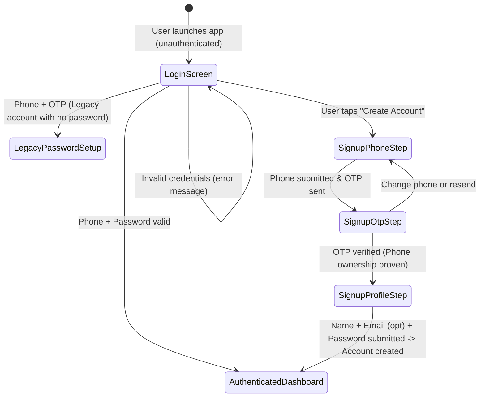

# MiniLedger Account, Counterparty Discovery & Balance Netting — Architecture & Implementation Plan

> **Phase:** 5 (Accounts, Counterparties & Settlement Netting)  
> **Status:** Proposed & Ready for Review  
> **Target Environment:** Node.js Express TypeScript Backend (`backend/`) & Expo React Native TypeScript Mobile (`mobile/`)  
> **Database:** PostgreSQL on Neon via Prisma ORM  

---

## 1. Existing Architecture & Relevant Files

### 1.1 Backend Architecture
- **Framework & Runtime:** Node.js (ES Modules, TypeScript, Express v4.21).
- **ORM & Database:** Prisma v6.4 targeting PostgreSQL (Neon).
- **Current Database Models ([schema.prisma](file:///e:/Internshala/CredSetu/MiniLedger/backend/prisma/schema.prisma)):**
  - `User`: `id`, `phone` (unique), `createdAt`.
  - `Loan`: `id`, `userId`, `friendName` (string), `amount` (Decimal 12,2), `dueDate` (Date), `type` (`LENT` | `BORROWED`), `isRepaid`, `repaidAt`, `createdAt`.
  - `OtpChallenge`: `id`, `phone`, `codeHash` (SHA-256), `expiresAt`, `attemptCount`, `consumedAt`, `createdAt`.
- **Authentication Service ([auth/](file:///e:/Internshala/CredSetu/MiniLedger/backend/src/modules/auth/)):**
  - `POST /api/auth/send-otp`: Generates 6-digit mock OTP, saves SHA-256 hash, logs to terminal in development.
  - `POST /api/auth/verify-otp`: Validates OTP hash, marks challenge consumed, upserts user by phone, issues JWT (`{ userId, phone }`).
- **Loan Service ([loans/](file:///e:/Internshala/CredSetu/MiniLedger/backend/src/modules/loans/)):**
  - `POST /api/loans`: Creates loan scoped to authenticated `userId`, stores `friendName` as unstructured string.
  - `GET /api/loans`: Lists user's loans with `type`, `status`, and `search` query parameters.
  - `GET /api/loans/:id`: Fetches loan by ID ensuring user ownership.
  - `PATCH /api/loans/:id/repay`: Marks loan repaid atomically (`isRepaid = true`, `repaidAt = now`).
- **Summary Service ([summary/](file:///e:/Internshala/CredSetu/MiniLedger/backend/src/modules/summary/)):**
  - Computes independent decimal totals for `totalLent`, `totalBorrowed`, `outstandingLent`, `outstandingBorrowed`, `overdueReceivable`, `overduePayable`.

### 1.2 Mobile Architecture
- **Framework:** Expo React Native (SDK 52), TypeScript.
- **Authentication UI ([auth/](file:///e:/Internshala/CredSetu/MiniLedger/mobile/src/features/auth/)):**
  - `LoginScreen.tsx`: Phone number input -> calls `sendOtpApi`.
  - `OtpScreen.tsx`: 6-digit OTP code entry -> calls `verifyOtpApi` -> sets token & user in storage.
- **Screens & Navigation:**
  - `DashboardScreen.tsx`: Bento grid of receivables and payables, quick navigation links.
  - `LentLoansScreen.tsx`: Dedicated view for money lent (they owe you).
  - `BorrowedLoansScreen.tsx`: Dedicated view for money borrowed (you owe them).
  - `AllLoansScreen.tsx`: Searchable directory with direction and status filters.
  - `AccountScreen.tsx`: User profile card, stat breakdown, ledger CSV export, sign out.
  - `AddLoanModal.tsx`: Modal to add loan with `LENT` / `BORROWED` selector, counterparty name input.

---

## 2. Proposed User & Authentication State Machine

### 2.1 State Diagram & Flow


### 2.2 Detailed Step-by-Step State Lifecycle

1. **First-Time Signup (Registration):**
   - **Step 1 (Phone Entry):** User enters 10-digit Indian mobile number (`+91XXXXXXXXXX`). Backend verifies format, checks if an active account already exists. If an account already exists, backend returns a non-revealing generic response or `ACCOUNT_EXISTS` code directing the user to login.
   - **Step 2 (OTP Challenge):** Short-lived OTP (5 min, max 3 attempts) is generated and stored as a hash.
   - **Step 3 (OTP Verification):** User enters the OTP. Backend verifies the code. Upon success, rather than immediately creating an active user without credentials, backend issues a temporary **Signup Token** (`signup_token`, valid for 15 minutes, claim: `{ phone, purpose: 'signup' }`).
   - **Step 4 (Profile Setup):** User provides:
     - `name`: Full Name (required, 2–80 chars, trimmed).
     - `email`: Email address (optional, validated format if provided).
     - `password`: Password (required, min 8 chars, containing at least 1 number and 1 letter).
     - `confirmPassword`: Client-side match validation.
   - **Step 5 (Account Creation):** Client submits profile with the `signup_token`. Backend verifies token, hashes password using `scrypt` (with cryptographically random 16-byte salt), creates the `User` record with `phoneVerifiedAt: now()`, and returns the session JWT (`token`) and `user` object. App immediately navigates to `Dashboard`.

2. **Standard Existing-User Login:**
   - User enters Phone + Password on the Login Screen.
   - Client sends `POST /api/auth/login` with `{ phone, password }`.
   - Backend normalizes phone, looks up user, computes constant-time password verification against stored `passwordHash`.
   - On success: returns JWT session token and user profile.
   - On failure: returns generic 401 (`INVALID_CREDENTIALS: Invalid phone or password`) to eliminate account enumeration risks.

3. **Legacy/Passwordless Account Upgrade Path:**
   - Existing users created during Phase 0–4 currently have `passwordHash: null`.
   - If an existing user attempts login, or enters their phone, the backend detects `passwordHash == null` and offers an **Account Setup / Password Creation** flow via OTP (`POST /api/auth/send-setup-otp` -> verify OTP -> set password). Existing users are never locked out!

---

## 3. Database Changes & Non-Destructive Migration Strategy

### 3.1 Prisma Schema Changes

```prisma
model User {
  id              String    @id @default(cuid())
  phone           String    @unique
  name            String?   // User display name (required for new signups)
  email           String?   // Optional email address
  passwordHash    String?   // Salted password hash (nullable for backward-compatible migration of legacy users)
  phoneVerifiedAt DateTime? // Timestamp when phone was verified via OTP
  createdAt       DateTime  @default(now())
  updatedAt       DateTime  @updatedAt @default(now())

  // Loans owned by this user
  loans           Loan[]    @relation("UserLoans")

  // Loans where this user is recorded as the registered counterparty
  counterpartyLoans Loan[]  @relation("CounterpartyLoans")

  @@index([phone])
}

model Loan {
  id                   String    @id @default(cuid())
  userId               String
  counterpartyUserId   String?   // Nullable FK to User: set if counterparty is a registered MiniLedger user
  friendName           String    // Counterparty display name (either registered user name or external contact name)
  counterpartyPhone    String?   // Optional phone for external counterparty
  amount               Decimal   @db.Decimal(12, 2)
  dueDate              DateTime  @db.Date
  type                 LoanType  @default(LENT)
  isRepaid             Boolean   @default(false)
  repaidAt             DateTime?
  createdAt            DateTime  @default(now())
  updatedAt            DateTime  @updatedAt @default(now())

  // Relations
  user                 User      @relation("UserLoans", fields: [userId], references: [id], onDelete: Cascade)
  counterpartyUser     User?     @relation("CounterpartyLoans", fields: [counterpartyUserId], references: [id], onDelete: SetNull)

  @@index([userId, dueDate])
  @@index([userId, isRepaid])
  @@index([userId, type, isRepaid])
  @@index([userId, counterpartyUserId])
  @@index([counterpartyUserId])
}

model OtpChallenge {
  id           String    @id @default(cuid())
  phone        String
  codeHash     String
  purpose      String    @default("signup") // "signup" | "recovery" | "verify"
  expiresAt    DateTime
  attemptCount Int       @default(0)
  consumedAt   DateTime?
  createdAt    DateTime  @default(now())

  @@index([phone, expiresAt])
}
```

### 3.2 Non-Destructive Migration Execution
1. All new columns on `User` are nullable (`name?`, `email?`, `passwordHash?`, `phoneVerifiedAt?`).
2. All new columns on `Loan` are nullable (`counterpartyUserId?`, `counterpartyPhone?`).
3. Existing records:
   - Existing loan records retain `userId`, `friendName`, `amount`, `dueDate`, `type: LENT`, `counterpartyUserId: null` (classified as external contacts).
   - No rows are dropped, altered destructively, or reset.
4. Migration file: `20261023170000_account_and_counterparties/migration.sql`.

---

## 4. API Endpoints & Request/Response Contracts

### 4.1 Authentication APIs

#### 1. `POST /api/auth/register/send-otp`
- **Purpose:** Initiates signup OTP challenge for a new mobile number.
- **Access:** Public.
- **Request Body:**
  ```json
  { "phone": "+919876543210" }
  ```
- **Response (200 OK):**
  ```json
  { "message": "Verification code generated." }
  ```
- **Error (409 Conflict):**
  ```json
  { "error": { "code": "PHONE_ALREADY_REGISTERED", "message": "An account with this phone number already exists. Please log in." } }
  ```

#### 2. `POST /api/auth/register/verify-otp`
- **Purpose:** Verifies phone ownership OTP and returns a short-lived signup authorization ticket.
- **Access:** Public.
- **Request Body:**
  ```json
  { "phone": "+919876543210", "otp": "654321" }
  ```
- **Response (200 OK):**
  ```json
  {
    "signupToken": "<jwt_signed_with_phone_and_purpose_signup>",
    "phone": "+919876543210",
    "expiresIn": 900
  }
  ```

#### 3. `POST /api/auth/register/complete`
- **Purpose:** Completes profile setup and creates user account with hashed password.
- **Access:** Requires `signupToken` in header or body.
- **Request Body:**
  ```json
  {
    "signupToken": "<token>",
    "name": "Aarav Sharma",
    "email": "aarav@example.com",
    "password": "Password123"
  }
  ```
- **Response (201 Created):**
  ```json
  {
    "token": "<session_jwt>",
    "user": {
      "id": "cuid-user-1",
      "phone": "+919876543210",
      "name": "Aarav Sharma",
      "email": "aarav@example.com",
      "createdAt": "2026-10-23T11:00:00.000Z"
    }
  }
  ```

#### 4. `POST /api/auth/login`
- **Purpose:** Authenticates user via Phone + Password.
- **Access:** Public.
- **Request Body:**
  ```json
  {
    "phone": "+919876543210",
    "password": "Password123"
  }
  ```
- **Response (200 OK):**
  ```json
  {
    "token": "<session_jwt>",
    "user": {
      "id": "cuid-user-1",
      "phone": "+919876543210",
      "name": "Aarav Sharma",
      "email": "aarav@example.com",
      "createdAt": "2026-10-23T11:00:00.000Z"
    }
  }
  ```
- **Error (401 Unauthorized):**
  ```json
  { "error": { "code": "INVALID_CREDENTIALS", "message": "Invalid phone number or password." } }
  ```
- **Special Case (403 PASSWORD_NOT_SET):**
  ```json
  { "error": { "code": "PASSWORD_NOT_SET", "message": "Your account was created via early OTP. Please complete password setup." } }
  ```

---

### 4.2 Registered User Search API

#### `GET /api/users/search?q={query}`
- **Purpose:** Discovers registered MiniLedger users by name or phone number.
- **Access:** Protected (`Authorization: Bearer <token>`).
- **Query Rules:**
  - `q`: Trimmed string, min 2 characters.
  - Matches user `name` (case-insensitive substring) or `phone` (numeric match).
  - Excludes the currently authenticated user (`id != req.user.userId`).
  - Limits results to 10 records.
- **Response (200 OK):**
  ```json
  {
    "data": [
      {
        "id": "cuid-user-2",
        "name": "Priya Sharma",
        "maskedPhone": "+91 98*** **210",
        "isRegistered": true
      }
    ]
  }
  ```
- **Privacy Guarantees:**
  - Never returns `passwordHash`, `email`, tokens, or full unmasked phone numbers (unless full phone was typed).
  - Rate-limited to prevent automated phone directory harvesting.

---

### 4.3 Loan Creation & Netting APIs

#### 1. `POST /api/loans` (Enhanced Contract)
- **Request Body:**
  ```json
  {
    "type": "LENT",
    "amount": "3000.00",
    "dueDate": "2026-11-15",
    "counterpartyUserId": "cuid-user-2",
    "friendName": "Priya Sharma",
    "counterpartyPhone": "+919876543210",
    "notes": "Dinner bill split"
  }
  ```
- **Ownership Invariant:** The loan is strictly owned by `req.user.userId`. Even if `counterpartyUserId` is provided, `counterpartyUserId` is only a reference to the other party; it does NOT alter the owner or create an unauthorized ledger row in the other user's account without their explicit interaction.

#### 2. `GET /api/loans/:id` (With Derived Pairwise Netting)
- **Response (200 OK):**
  ```json
  {
    "data": {
      "id": "loan-1",
      "type": "LENT",
      "amount": "5000.00",
      "dueDate": "2026-11-20",
      "friendName": "Priya Sharma",
      "counterpartyUserId": "cuid-user-2",
      "isRegisteredCounterparty": true,
      "isRepaid": false,
      "repaidAt": null,
      "createdAt": "2026-10-23T11:00:00.000Z",
      "pairwiseNetting": {
        "isApplicable": true,
        "counterpartyId": "cuid-user-2",
        "counterpartyName": "Priya Sharma",
        "grossLentOutstanding": "5000.00",
        "grossBorrowedOutstanding": "2000.00",
        "netDirection": "RECEIVABLE",
        "netAmount": "3000.00",
        "settlementStatusText": "Priya owes you net ₹3,000"
      }
    }
  }
  ```

#### 3. `GET /api/summary` (With Gross and Net Metrics)
- **Response (200 OK):**
  ```json
  {
    "totalLent": "12000.00",
    "totalBorrowed": "5000.00",
    "outstandingLent": "8000.00",
    "outstandingBorrowed": "3000.00",
    "overdueReceivable": "1500.00",
    "overduePayable": "0.00",
    
    // Netting Aggregates across registered counterparties
    "netReceivableTotal": "6000.00",
    "netPayableTotal": "1000.00",
    
    // Backward-compatible fields
    "outstandingAmount": "8000.00",
    "overdueAmount": "1500.00",
    "totalRepaid": "4000.00"
  }
  ```

---

## 5. Registered-User Search & External-Person Handling

| Feature Aspect | Registered Counterparty | External Person ("Someone outside MiniLedger") |
| :--- | :--- | :--- |
| **Identifier** | `counterpartyUserId = "cuid-user-2"` | `counterpartyUserId = null` |
| **Display Name** | Auto-filled from user's registered name (`friendName`) | Custom text typed by user (`friendName`) |
| **Phone** | Auto-filled from user profile (`counterpartyPhone`) | Optional phone number typed by user |
| **Netting Permitted?** | **YES** (Linked reliably by immutable `counterpartyUserId`) | **NO** (Never auto-netted based on name matching) |
| **Badge in UI** | `[✓ Registered User]` (Obsidian Pill) | `[External Contact]` (Subtle Outline Pill) |

---

## 6. Loan Netting and Settlement Accounting Rules

### 6.1 Mathematical Formulation
For any two registered users `User A` (Current User) and `User B` (Counterparty):
1. Filter all loans owned by `User A` where `counterpartyUserId == User B.id` and `isRepaid == false`:
   - $L = \sum \text{amount of active loans where } type = \text{'LENT'}$
   - $B = \sum \text{amount of active loans where } type = \text{'BORROWED'}$
2. Derive Net Balance:
   - If $L > B$: Net Balance is a **Net Receivable** of $L - B$ ("$User B$ owes you net ₹$(L - B)$").
   - If $B > L$: Net Balance is a **Net Payable** of $B - L$ ("You owe $User B$ net ₹$(B - L)$").
   - If $L = B$: Net Balance is **Settled ($0.00$)** ("All mutual balances currently offset").

### 6.2 Overdue Rules & Prohibitions
- **RULE 1 (No Auto-Repayment):** Netting is purely a derived presentation layer. Original individual loan rows are NEVER deleted, updated, or marked `isRepaid = true` simply because balances offset.
- **RULE 2 (No Net Overdue):** Never subtract overdue borrowed from overdue lent. Overdue status belongs strictly to specific loans with past calendar due dates.
- **RULE 3 (Due Dates):** In the netting card, display the **earliest upcoming or past due date** among the contributing unpaid loans as context, rather than a synthetic generated due date.

---

## 7. Frontend Screen and Navigation Changes

### 7.1 Screen Directory & Flow Updates
1. **Login Screen ([LoginScreen.tsx](file:///e:/Internshala/CredSetu/MiniLedger/mobile/src/features/auth/LoginScreen.tsx)):**
   - Inputs: Phone Number + Password.
   - Action: "Sign In" button -> direct login to Dashboard.
   - Links: "Create Account" -> opens Signup flow; "Setup Password via OTP" for legacy users.
2. **Signup Screen / Flow ([SignupScreen.tsx](file:///e:/Internshala/CredSetu/MiniLedger/mobile/src/features/auth/SignupScreen.tsx)):**
   - Step A: Phone Number + "Send Verification Code".
   - Step B: 6-Slot OTP entry (with countdown & resend).
   - Step C: Profile Setup (Full Name, optional Email, Password, Confirm Password).
   - Action: "Complete Registration" -> logs in to Dashboard.
3. **Add Loan Modal ([AddLoanModal.tsx](file:///e:/Internshala/CredSetu/MiniLedger/mobile/src/components/AddLoanModal.tsx)):**
   - Lent / Borrowed Direction toggle.
   - Counterparty selection mode:
     - Search bar with live debounce query to `/api/users/search`.
     - Results dropdown showing matching registered users with `[✓ MiniLedger User]` pill.
     - Option button: *"Add someone outside MiniLedger"* to enter custom friend name.
   - Selected counterparty card with clear avatar and "Change" option.
4. **Loan Details Modal ([LoanDetailsModal.tsx](file:///e:/Internshala/CredSetu/MiniLedger/mobile/src/components/LoanDetailsModal.tsx)):**
   - Header with `[Registered User]` or `[External Contact]` tag.
   - Original transaction breakdown (Amount, Date, Due Date, Status).
   - **Mutual Balance Netting Card** (rendered when counterparty is registered):
     - Gross Lent vs Gross Borrowed.
     - Bold net remaining obligation.
     - Disclaimer: *"Derived mutual balance. Transactions remain individually recorded."*
5. **Dashboard Screen ([DashboardScreen.tsx](file:///e:/Internshala/CredSetu/MiniLedger/mobile/src/features/dashboard/DashboardScreen.tsx)):**
   - Clearly labeled Gross Receivables & Gross Payables.
   - Netting insight card summarizing net receivables across registered friends.
6. **Account Screen ([AccountScreen.tsx](file:///e:/Internshala/CredSetu/MiniLedger/mobile/src/features/account/AccountScreen.tsx)):**
   - Displays User Name, Phone, and Email.
   - Phone Verified badge.
   - Sign Out action.

---

## 8. Security and Privacy Controls

1. **Password Hashing:**
   - Use Node.js built-in `crypto.scrypt` with a cryptographically secure 16-byte random salt per user. Format: `salt:derivedKeyHex`.
   - Verification uses constant-time comparison `crypto.timingSafeEqual` to thwart timing side-channel attacks.
2. **Rate Limiting & Failed Login Protections:**
   - 5 failed login attempts lock login for 15 minutes.
   - Generic 401 response without disclosing whether the phone number exists.
3. **Privacy in User Search:**
   - Mask phone numbers: `+91 98*** **210`.
   - Never return email or password hash in search endpoints.
   - Max 10 results returned.
4. **User Data Isolation:**
   - Every read and write to loans strictly verifies `userId == req.user.userId`.
   - Even when linking `counterpartyUserId`, the loan is solely owned and mutated by the creating user.

---

## 9. Backward Compatibility and Existing-Data Migration

- **Existing Users:**
  - Have `phone` and `createdAt`. Their `passwordHash` will be `null`.
  - When a legacy user enters their phone on Login, the backend detects `passwordHash == null` and returns `{ code: "PASSWORD_NOT_SET" }`.
  - The client seamlessly prompts: *"Your account needs a password. Let's verify your phone via OTP to set it up."*
  - User completes OTP verification -> sets password -> `passwordHash` is saved.
- **Existing Loans:**
  - Retain `counterpartyUserId = null`.
  - Displayed as `External Contact`.
  - 100% of historical loan records continue to function without data loss.

---

## 10. Unit, Integration, and Regression Tests

### 10.1 Backend Test Suites (Vitest)
1. **Authentication Tests (`backend/tests/auth.test.ts`):**
   - Signup OTP request and verification issuing `signupToken`.
   - Profile completion creating user with hashed password.
   - Duplicate phone signup rejection (409).
   - Phone + password login success.
   - Invalid password failure (401 generic).
   - Rate limit on 5 failed password attempts.
   - Legacy user password setup via OTP.
2. **User Search Tests (`backend/tests/user-search.test.ts`):**
   - Unauthenticated search rejected (401).
   - Search by name substring and phone.
   - Verified that search results mask phone and do not leak password or email.
   - Current user excluded from search results.
3. **Netting & Loan Settlement Tests (`backend/tests/netting.test.ts`):**
   - Loan creation with registered `counterpartyUserId`.
   - Loan creation with external counterparty (`counterpartyUserId: null`).
   - Pairwise netting when Lent > Borrowed.
   - Pairwise netting when Borrowed > Lent.
   - Pairwise netting when Lent == Borrowed (settled).
   - Ensuring repaid loans are excluded from active net calculations.
   - Ensuring external contacts with identical names are NOT netted together.
   - Verifying original loan rows and due dates remain untouched.
   - Decimal-safe monetary accuracy.
4. **Regression Tests (`backend/tests/loans.test.ts`):**
   - All 25 existing loan tests pass without regression.

### 10.2 Mobile Type & Lint Checks
- `npx tsc --noEmit` in `mobile/` with zero errors.

---

## 11. Implementation Order, Dependencies, Risks & Rollback

### Implementation Sequence
```
Stage 1: Documentation & Phase Document (docs/phases/PHASE-5-ACCOUNTS-COUNTERPARTIES-NETTING.md, SPEC.md, etc.)
Stage 2: Database Schema & Migration (User profile fields, Loan counterparty fields)
Stage 3: Password Hashing Library & Auth Services (Signup, Password Login, Legacy Setup)
Stage 4: User Search Endpoint (Privacy-safe query and phone masking)
Stage 5: Loan Service Netting Logic & API Updates
Stage 6: Backend Tests (Auth, Search, Netting, Regression) -> Verify all pass
Stage 7: Mobile API Client & Type Definitions
Stage 8: Mobile Auth Screens (Login with password, Signup with OTP & profile setup)
Stage 9: Mobile Add Loan (Registered user discovery & external contact fallback)
Stage 10: Mobile Loan Details & Dashboard (Derived pairwise netting card)
Stage 11: End-to-End Testing & Verification on Mobile and Backend
Stage 12: Documentation finalization & Git commits
```

### Risks and Rollback Strategy
- **Risk:** Existing users cannot log in if password is required immediately.  
  **Mitigation:** Provide explicit `PASSWORD_NOT_SET` response that gracefully triggers OTP password setup.
- **Risk:** Database reset during migration.  
  **Mitigation:** All new schema fields are nullable with default values; strictly use non-destructive `ALTER TABLE` statements.
- **Rollback:** Migrations can drop added columns without impacting base `User(id, phone)` or `Loan(id, userId, friendName, amount, dueDate, type, isRepaid)`.

---

## 12. Explicit Identification of Ambiguous Requirements & Recommended Defaults

1. **Email Requirement on Signup:**
   - *Ambiguity:* The prompt states: *"Email address — required if confirmed in the approved plan; otherwise optional."*
   - *Recommendation:* Make `email` **optional**. Many users only have mobile numbers; making email optional reduces signup friction while still providing profile completeness for those who provide it.
2. **External Contact Phone Number:**
   - *Ambiguity:* Should external people have a required phone number?
   - *Recommendation:* Make external contact phone number **optional**. Users frequently track informal loans (e.g. "Chai Stall", "Roommate") without needing to input a formal phone number.
3. **Mutual Visibility Invariant:**
   - *Ambiguity:* If User A records a loan to User B, does it automatically create a loan row in User B's account?
   - *Recommendation:* **No.** MiniLedger is a personal ledger. Creating unsolicited records in another user's personal ledger without their acceptance violates user autonomy and privacy. Netting calculates the relationship relative to the viewing user's ledger.
